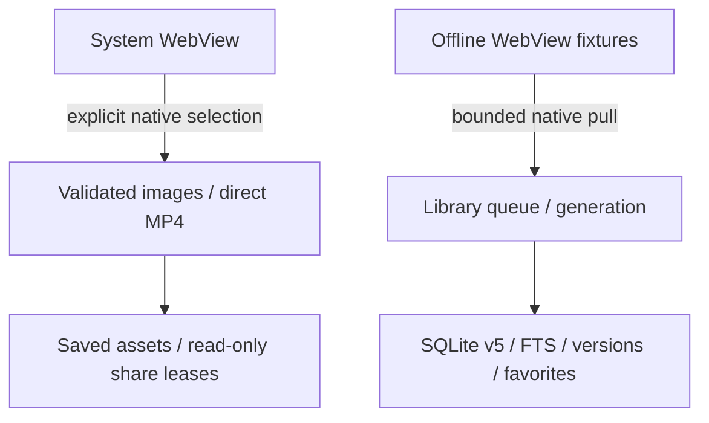

# Xs architecture — app-owned library and native-pull plan

当前v5与可靠性源码见 [本轮证据](ROUND_D_EVIDENCE.zh-CN.md)，API26/30/36 CI当前PENDING。历史 [阶段C](ROUND_C_EVIDENCE.zh-CN.md) 与 [A/early-B](IMPLEMENTATION_EVIDENCE.zh-CN.md) 报告不覆盖新代码；下文区分实现和未启用的现场目标。

Updated 2026-11-07. Read [product](product.md), [ADR-0002](adr/0002-local-library-media.md), [ADR-0003](adr/0003-native-pull-delivery.md), [implementation](IMPLEMENTATION_PLAN.zh-CN.md) and [acceptance](ACCEPTANCE_MATRIX.zh-CN.md). This describes the target and names existing foundations separately; it does not claim live integration.

## 1. Runtime and target boundaries

`app-android` hosts retained System WebView with manual link favorites, selected-post media downloads and outbound file sharing. `xs-runtime` provides library storage/UI, fixtures, strict backups and explicit metadata consolidation. `dev-harness` is synthetic and offline. The packaged observer, reversible cleanup and own-action admission have no enabled real-X adapter; diagrams do not grant those privileges. Media support is bounded standard H.264/AAC MP4, with container/sample validation and representative decoding, not all-format or whole-film decode certification.

## 2. Browser engineering and reuse

Use reviewed ChatGPT Studio patterns for page ownership independent of Activity, Profile binding before web use, controlled child windows, navigation categories, context reattachment and invalidated callbacks. See the [pinned reuse manifest](CHATGPT_STUDIO_REUSE.zh-CN.md). Do not import all chat workflow features, authentication domains, payloads or signing identity.

Start with one active web session. Runtime capability checks, not OS version assumptions, determine optional profile support. A local library is not a verified X account or a proxy. Controlled authentication navigation must not gain observation privileges. Keep normal browsing available when enhancement is disabled.

Page retention is not capture permission: background/hidden/covered views stop observation timing. Do not rely on foreground-service hacks, fake audio or unbounded retained tabs. Process death means reloading the website; local history is what remains available offline.

## 3. Native-pull observation contract

Prefer local scripts packaged with the signed app and native-controlled calls that retrieve finite event batches/snapshots. Native code controls the target WebView, allowed current route/origin, foreground/overlay state, consent, library generation and navigation reason. Do not expose a general Java object or any SQL/path/Intent/export/delete operation to pages.

Returned JSON remains untrusted: same-origin scripts/DOM can affect content, and a random window key/token is not identity authentication. Validate both before queuing and immediately before persistence. Reject stale document/navigation/space callbacks, oversized payloads, unknown fields/commands and sensitive contexts. Review strict parser behavior, duplicate keys, trailing content, nesting, byte limits and unsupported numeric forms before activation; a JSONObject constructor alone is not a security proof.

Current limits in the older policy are starting budgets, not performance results: <=64 KiB envelope, <=16,000 body characters, <=100 author characters, 20 accepted observations/second with a burst budget of 40. Define a bounded pending queue (initial target <=128 events) and overload pause/recovery behavior during implementation. Invalid-message floods must also be bounded before expensive parsing. No unbounded executor is accepted as the final write controller.

Rapid open-and-return must not be missed by polling the current URL every few seconds. Maintain bounded page observations and native navigation identity with tested flush/transition behavior. Refresh, back/forward, reload, restored state and actual deliberate new entry have distinct reasons. Content updates enrich a post; they are not new reading events.

The [existing inactive observation envelope](contracts/observation-v1.md) is a starting point. A future origin-scoped listener is optional, not required to ship the first native-pull loop; it must preserve all current permissions and non-sensitive-route checks.

## 4. Library ownership and preserving migration

Default library belongs to the application, not to the active X login. Distinguish:

- `library_id`: native local data ownership; optional private libraries may be user-created later.
- `browser_profile_id` / session context: browser cookies and website storage; never exported with the library.
- `actor_hint` / provenance: optional metadata for confirmed own social actions, not library ownership.

A website account switch invalidates observation context and unconfirmed social attribution; it does not delete or implicitly switch local favorites/assets. Do not pass a local UUID or scraped handle to the legacy `bindAuthenticatedAccount` as if authenticated.

SQLite v5 preserves v1–v4 namespaces, library mappings, counts, times, category links and FTS. Separate own-action and action-event tables retain actor provenance, unknown time, related posts and reversal state. Favorites and local media/share leases remain independent. `snapshot_versions` retains accepted text versions and `posts.current_snapshot_key` identifies the current one; historical-text search is optional and returns current-post rows, with a separate read-only version browser. Its panel retains at most 50 rows, with previous/next pages and debounced version-text search; bodies load only after selection. Paged browsing reaches versions beyond the newest 200 without accumulating unbounded UI rows. Explicit consolidation creates another space and preserves all sources; failed transactions keep original data. Browser sessions and library ownership are separate.

## 5. Event and snapshot semantics

| Record | Meaning |
| --- | --- |
| OPEN_POST | Opted-in deliberate entry into a valid detail context; no dwell delay. LINK_ONLY may be stored immediately, then enriched. |
| FEED_VISIBLE | Independent, opt-in **timeline exposure without opening the post**, 1.2s/3s (default)/5s continuous visible dwell, normalized readable area and measured duration. Not proof of reading and does not increase opened_count. |
| Own action | Confirmed own post/reply/quote/repost or provenance-checked import; cancellation/failure/seeing a repost is not success. |
| FAVORITE | Xs-native relationship and local time, independent of X server bookmarks/likes. |
| LOCAL_SAVE | Existing manual link import/save; retained as distinct legacy semantics, not silently inflated into reading. |

One navigation ID admits at most one open per library/context; increasing message sequences are not sufficient. Original publication time, action time, open time and feed time remain separate, with unknown values preserved. Snapshot quality is LINK_ONLY/PARTIAL/COMPLETE/LEGACY_UNKNOWN with explicit source/capture time. COMPLETE establishes only accepted visible DOM text, never hidden/server-full content. Native detail evidence controls that quality; a newer shorter COMPLETE snapshot can become current, while PARTIAL cannot overwrite COMPLETE. Preserve all prior versions and use SnapshotPolicy for consolidation; version browsing never switches the current pointer.

### Feed dwell design target (XS-14 baseline moves into B)

See [feed dwell specification](FEED_DWELL_PLAN.zh-CN.md) / [ADR-0004](adr/0004-feed-dwell.md). A locally packaged X-specific observer will verify actual timeline cards, foreground visibility and readable-area ratio using bounded page observation; native code owns selected library, feature consent, current route, generation and monotonic timing. Thresholds are **1.2, 3 (recommended default), 5 seconds**; no threshold applies to deliberate OPEN_POST.

Each continuous qualified exposure uses a stable `exposure_id`, persists FEED_VISIBLE separately from opening/favoriting and updates the same event duration as it continues. A real subsequent exposure may form a new event. The duration/threshold/quality fields and v5 preserving migration are implemented for fixtures; live DOM adaptation remains pending. Offline filters must support duration range and “never opened” in the local library without inferring server read status. Long cards normalize against actually readable viewport content; background, overlay, sensitive route and idle constraints require test fixtures and real-device evidence. Native preferences implement the three thresholds and SQLite indexes measured duration separately. Duration is a sampled lower bound: qualified updates coalesce to one-second intervals, with one final capped lower bound at ten minutes and no repeated cap writes. Pausing the packaged observer clears its JS timer; resuming creates fresh timing context. Synthetic DOM/heap stress does not establish actual battery use or multi-day stability.

## 6. Writes, deletion and invalidation

All local writes, import batches, favorite changes, asset completion and destructive operations go through a unified native controller with bounded work. Queued units carry native library/document/generation identity; a clear or cancellation advances invalidation before a storage transaction. Recheck at commit time so a late callback cannot restore deleted records.

Separate unfavorite, history clear, asset deletion, cache clear, browser logout/session clear and complete library deletion. Favoriting must not request an X server mutation. Importing never invents opens. Whole-library deletion persists a tombstone before its queue barrier, blocks ordinary old/new tickets, and checks revocation inside archive database write transactions. Media batch helpers require that same shared library writer. Only a deleted default UUID rotates. Erase scoped media before metadata; preserve a failed cleanup as pending and retry it at startup or from the management UI. Other scopes/browser sessions and existing share leases remain. Deletion is not undone by restored callbacks or stale intents.

## 7. Media and asset pipeline

Resolve only explicitly selected media from permitted post contexts. Resolver output is an untrusted candidate, not an arbitrary network proxy request. Validate HTTPS destinations/redirects, resource type, bounds, generated filenames, disk quota and retry budget; reject local/private-network probing and unsafe paths. No DRM, paywall or authorization bypass. Avoid generic network-response interception and credential logs.

Download images and available complete videos first. `blob:` identifiers, manifests and fragments are not completed MP4s. If permitted HLS/DASH is actually needed, test resolution, assembly, audio/video synchronization and shareable output separately. Lack of an allowed media source is an explicit unsupported/failure result, not permission to broaden extraction.

Write temporary data, verify actual type/completeness/playback, then atomically register the asset. Resume only with verified range/object consistency; otherwise retry from the start explicitly. Keep user downloads separate from cache. JobScheduler provides actual persisted task lifetime: explicit API34+ requests first try user-initiated transfer jobs, then regular jobs if refused; API26–33 use regular jobs. Network/storage constraints and exponential backoff remain under Android control. Candidate URLs are AndroidKeystore AES-256-GCM ciphertext bound by AAD to task/library/canonical post/kind; job extras hold only task/library identities. Automatic transient retries are at most three total attempts per explicit run, each from byte zero. onStopJob preserves a paused task and respects OS rescheduling. Startup keeps a missing job paused for explicit retry instead of bypassing user/system stop. Completion/cancel clears the sealed candidate; no range-resume or prompt-background guarantee.

Assets are separate from posts with stable local IDs, content hashes, MIME, size/duration/dimensions, source-post links, local timestamps, state and categories. Source-page disappearance does not delete completed local files. User export to Photos/Files is separate from private app storage and never implicit.

## 8. Outbound sharing

Native ShareCoordinator handles canonical links, explicit text with source, and selected actual completed media. Use ACTION_SEND/ACTION_SEND_MULTIPLE, accurate MIME, content URI/ClipData and temporary read grants. Provider exposure is restricted to chosen shareable assets/copies, never root/library databases, credentials, keys or unfinished files. No write grants.

User selects installed app, conversation and sending. WeChat/QQ/Feishu/Telegram are compatibility targets, not token/SDK/contact integrations. Direct conversation shortcuts depend on the recipient. A chooser completion cannot prove sending/delivery and must not trigger automatic retry.

Protect asynchronous receiver reads with a bounded share copy/lease and documented cleanup; deleting the source or clearing cache must not immediately break an active share. Sharing intentionally passes selected content to another app; no Xs upload service is used, but the receiver may upload it. Preserve originals on target/format/size failure; offer explicit alternatives, not silent quality loss.

## 9. UI and release boundaries

Preserve X web navigation. Add minimal native favorite/download/share/library actions. Native library provides history, favorites, own content and assets with search/category/time filters. Posts support batch favorites/categories/tag append-or-replace/unfavorite (up to 200); asset search is paged and filtered by keyword/type/state, with selection/category/delete/share and single-file or multi-file ZIP export (up to 200MiB). Only completed actual files export/share; these mutations use shared library writers. Optional page-card actions and reversible styles must not block the native path or alter login/security/composers.

Capture and filtering start off and have separate consent; cache is not durable saved media, and SQLite is not currently claimed encrypted. Reuse of device-key patterns does not encrypt existing FTS/WAL/backups automatically. Live login, target-device media, receiver apps, migrations, backups, signing and licensing need their own evidence.

[Roadmap](roadmap.md) and [acceptance matrix](ACCEPTANCE_MATRIX.zh-CN.md) define stage completion. W0 gates enabling unvalidated real-site automation and release, not parallel offline development. Legacy APK integration contracts are retained history. No production release, website deployment or modification of the user's machines is authorized by this plan.

## 10. Explicit portability and consolidation

Metadata JSONL is bounded to 16 MiB / 20,000 records, schema 3/4/5, strict UTF-8/types/columns/references and a corruption checksum. Import creates a new UUID scope in one transaction, checks FKs and FTS, preserves sources/default, and never grants a browser identity from stored claims. Files are plaintext; media/downloads/web sessions/keys are excluded.

Consolidation snapshots 2–4 registered sources through shared queues, validates an immutable preview, and copies that exact snapshot into a new scope after confirmation. Total 8 MiB / 20,000 source records; normal edits after preview require another preview, erasure invalidates it. Conflicting legacy action provenance or overflowing notes abort rather than discard content. Idle writer recycling uses instance-bound epoch tickets; all-busy capacity failure occurs before target rows are published. See evidence for policies and limitations.

### Passphrase-encrypted resource backups

This is a separate format from plaintext metadata JSONL. `EncryptedLibraryBackup` frames bounded metadata and completed media by ordinal, descriptor, length and SHA-256; filenames never act as restore paths. AES-256-GCM authenticates 64KiB chunks, header/ordinal AAD, a final empty chunk and EOF. PBKDF2-HMAC-SHA256 uses 600,000 iterations and a random salt; a fresh nonce base is used per backup. The 8–1024-character user passphrase is not persisted, and forgetting it prevents recovery.

The plaintext payload is at most 512MiB / 500 completed assets, including metadata ≤16MiB / 20,000 records; images remain ≤20MiB and videos ≤100MiB. Overflow rejects the operation rather than truncating content. Tasks, pending URL ciphertext/candidates, browser Profiles/sessions, keys and share leases are excluded. All authentication completes into private staging before payload parsing and preview; strict schema/FK/source checks plus per-resource hash and native image/MP4 checks precede commit.

Restore allocates a new UUID and never overwrites a source/default. Media files and directory state commit first; archive registration commits last. Private durable pending markers allow startup to discard an unregistered target after interruption while preserving a registered result. This does not encrypt the working SQLite/FTS/WAL or establish whole-device recovery. Dedicated core/Android/SAF UI evidence belongs to the current source, not the earlier metadata-only CI.

### Candidate signing boundary

The manual `xs-signed-candidate` workflow takes an exact reviewed commit on main ancestry, configured environment secrets and a pinned certificate SHA-256. It builds/verifies an internal candidate and provenance artifact without publishing a GitHub Release/store build. Production key/certificate configuration is absent; physical upgrade/rollback and release acceptance remain open. The root GPL-3.0 license remains effective pending separate rights/notice review.
